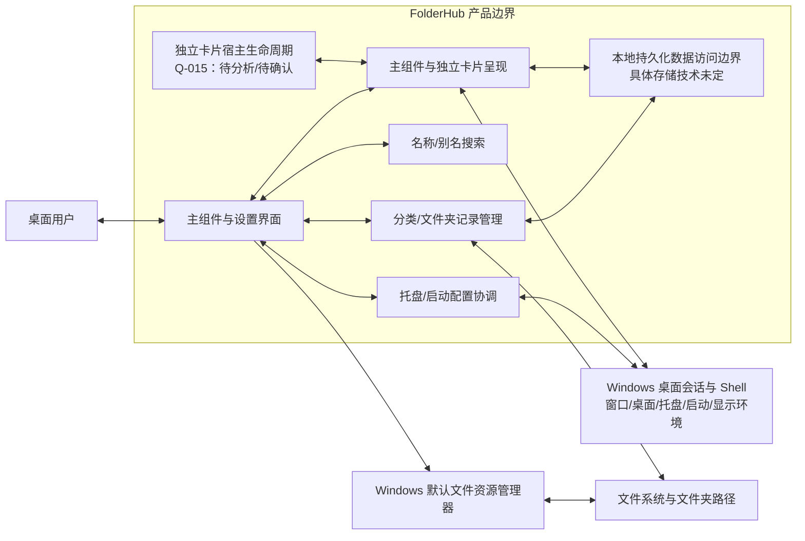

# FolderHub P3-01 系统上下文与边界分析

- 文档编号：FH-HLD-CTX-001
- 版本：v0.1
- 日期：2026-11-20
- 工作流规范：software-predev-workflow-skill V2.6.1
- 阶段：P3_HIGH_LEVEL_DESIGN
- 状态：DRAFT / ANALYSIS（非设计基线）
- 输入需求基线：REQ-BL-1.0（SRS_FolderHub_v0.11.md）
- 关联任务：TASK-017

> 本文是 P3 概要设计的首轮上下文分析。内容以 REQ-BL-1.0 为约束；逻辑边界和上下文关系属于设计分析，不代表用户已批准具体架构、技术栈、数据库、Windows API 或进程模型。

## 1. 目的与分析原则

本工作包识别 FolderHub 的目标用户、外部系统、运行环境、产品边界及主要信息流，为后续架构候选比较和模块划分提供共同上下文。

原则：
1. 以 REQ-BL-1.0 为唯一需求输入基线，不新增或改写用户需求。
2. 区分已确认产品行为、逻辑分析、设计假设和待验证技术事项。
3. 不将逻辑组件图解释为进程部署图；尤其不预设独立卡片由主进程、独立进程或 Windows 服务承载。
4. 未验证的 Windows 桌面集成能力均标记 `NEEDS_VALIDATION`。

## 2. 系统目标与用户

FolderHub 面向 Windows 本地交互式桌面用户，通过桌面壁纸层主组件及可独立显示的文件夹卡片，帮助用户分类管理常用文件夹并快速打开目标目录。

主要用户：
- **桌面用户/配置者**：创建和维护分类、文件夹记录、别名、用途说明、路径、显示设置和独立卡片。
- **桌面使用者**：通过主组件、托盘入口或独立卡片查找并打开已登记文件夹。

首版按已批准范围面向单用户交互式桌面环境；不承诺 Windows Server Core 或 RDS 多用户环境。

## 3. 系统上下文图（逻辑视图）

说明：
- 图中 `DATA` 是逻辑持久化边界，不代表已经选择 SQLite、文件配置或其他存储技术。
- `LIFE` 是明确保留的待决边界。Q-015 未完成前，不得把它映射为已选定的进程、服务或宿主架构。
- Windows 桌面会话、Shell、托盘、启动入口、显示器与 DPI 环境属于外部运行平台；FolderHub 通过待设计的集成边界与之交互。
- 打开文件夹的产品目标是调用 Windows 默认文件资源管理器访问目标路径；本图不指定具体 Win32 API 或调用方式。

## 4. 外部参与者与交互边界

| 外部参与者/系统 | 交互内容 | 需求/决策依据 | 设计边界 |
|---|---|---|---|
| 桌面用户 | 管理分类、文件夹记录、别名、用途说明、搜索、设置和卡片 | FR-001～FR-008、FR-013～FR-017；UIR-001/002 | 用户意图与业务校验由 FolderHub 提供；具体界面已在 P3 Demo 中作交互预览 |
| Windows 桌面会话 / Shell | 桌面层显示、窗口位置、托盘、启动配置、显示器与 DPI 环境 | FR-012～FR-015、FR-019；NFR-001/002 | API、窗口层级、启动注册和显示环境查询方案均待验证 |
| Windows 文件系统 | 访问和检查用户登记的文件夹路径 | FR-009、FR-010、FR-018；BR-003/009/010；NFR-003 | FolderHub 管理的是路径与登记记录；删除登记不得删除磁盘真实目录 |
| Windows 默认文件资源管理器 | 打开目标文件夹 | FR-011 | 只定义产品级打开结果，不预设具体 API、命令参数或进程启动实现 |
| 本地持久化介质 | 保存分类、文件夹记录、设置和桌面位置状态 | FR-001～FR-019、NFR-002 | 仅确认跨重启保存要求；数据库、文件格式、迁移和备份策略留待 P3/P4 |

## 5. 产品边界

### 5.1 FolderHub 负责
- 分类与文件夹记录的创建、编辑、删除和排序；多分类关联及已确认业务规则。
- 文件夹名称、别名、用途说明和路径信息管理。
- 搜索、路径有效性处理及文件夹打开请求。
- 主组件、独立卡片的用户可见呈现、位置/锁定设置和透明度设置。
- 托盘入口、开机启动配置及退出后独立卡片保留开关的产品行为。
- 按 FR-019 处理显示环境变化后的用户可见位置恢复结果。

### 5.2 由 Windows 平台提供
- 用户会话、桌面与 Shell 环境、系统托盘、文件系统、默认文件资源管理器、显示器/DPI 信息和系统启动能力。
- 实际可用能力及兼容性必须按目标 Windows 版本验证，不能仅凭 API 文档推定通过。

### 5.3 明确不属于当前首版承诺
- Windows Server Core、RDS 多用户环境。
- 高级筛选、分类父子层级/嵌套。
- 以删除 FolderHub 登记记录的方式删除真实磁盘目录。
- 未经用户批准的云同步、跨设备同步或多用户共享能力。
- 未经验证的桌面层级、系统集成或兼容性实现承诺。

## 6. 运行环境与总体约束

| 维度 | 已批准约束/现状 | 对设计的影响 |
|---|---|---|
| Windows 客户端 | Windows 10（22H2）/Windows 11（x64）本地交互式桌面 | 桌面呈现、托盘、启动、文件夹打开需在两类环境验证 |
| Windows Server | Server 2012/2012 R2：Server with a GUI；Server 2016+：Desktop Experience；单用户交互式桌面 | 目标支持范围不等于已验证支持；关联 RISK-001 |
| 不支持环境 | Server Core、RDS 多用户 | 不纳入首版验收承诺 |
| 数据持久性 | 主组件及每张独立卡片的位置/锁定状态跨重启保存；透明度自动保存 | 需要稳定的持久化和恢复边界，技术选型未定 |
| 显示环境变化 | 按 FR-019 保持可见性；可用时尽量保留原显示器及相对位置，不可用/越界时迁移至主显示器可见位置 | 算法、坐标体系、DPI 换算、显示器标识均待设计/验证 |
| 独立卡片退出行为 | 全局统一保留开关，默认开启；开启时主程序退出后卡片继续显示，关闭时全部关闭 | 技术生命周期由 Q-015 跟踪，当前不得冻结架构 |
| 数据保护 | 删除文件夹登记不删除真实目录；路径异常不自动清除记录 | 记录管理与文件系统操作必须隔离 |
| 质量属性指标 | 当前 SRS 未定义响应时间、资源占用上限、数据库容量等数值 | 不得自行补入量化指标；后续如需新增须走需求变更/澄清 |

## 7. 核心信息对象（概念级）

以下仅为从已批准需求推导的概念对象，不是最终数据库表或字段定义：
- **Category**：平级分类及其显示顺序。
- **FolderEntry**：文件夹真实路径、名称、可选别名、用途说明及有效性状态。
- **FolderCategoryAssociation**：文件夹与多个分类之间的关联，以及分类内独立排序信息。
- **MainComponentState**：主组件是否固定、位置、锁定状态及透明度设置。
- **IndependentCardState**：每张卡片对应的文件夹记录、位置、锁定状态和显示状态。
- **GlobalSettings**：开机启动、退出主程序后是否保留独立卡片等全局设置。

实体关系、唯一约束、路径规范化、序列化格式、事务边界、版本迁移和备份恢复均留待后续数据设计。

## 8. 主要信息流（概念级）

1. 用户维护分类/文件夹记录 → FolderHub 校验业务规则 → 保存记录与分类关联。
2. 用户输入名称或别名 → 搜索组件按已确认规则过滤记录 → 主组件展示结果。
3. 用户请求打开文件夹 → FolderHub 读取目标路径并处理路径异常 → 请求 Windows 默认文件资源管理器打开路径。
4. 用户固定独立卡片 → FolderHub 保存卡片显示状态与位置/锁定信息 → 桌面呈现层显示卡片；主程序退出时按全局开关决定卡片是否继续显示（宿主实现仍由 Q-015 决定）。
5. 显示器/分辨率/DPI 环境变化 → 读取组件原位置与当前可见桌面边界 → 按 FR-019 恢复或迁移组件位置；具体算法待设计。

## 9. 设计未知项与后续处理

| 未知项 | 当前分类 | 关联 | 后续动作/门禁 |
|---|---|---|---|
| 独立卡片宿主生命周期（主程序退出后继续显示） | D2 未决 | Q-015、RAW-013、ADR-007/021 | TASK-018 完成候选架构比较、风险和回退分析；相关架构批准/基线前必须获得必要确认 |
| 主组件/卡片的 Windows 桌面层级和窗口集成 | `NEEDS_VALIDATION` | FR-014/016/017、NFR-001 | 在目标 Windows 版本建立验证原型；验证前不声称实现可行或兼容 |
| 本地数据存储技术与配置格式 | 未决设计选择 | FR-001～FR-019、NFR-002 | 形成候选方案、迁移/备份/恢复权衡；不在本文件预选技术 |
| 多显示器、坐标与 DPI 恢复算法 | 未决设计细节 | FR-019、Q-026、ADR-033 | 设计坐标模型、显示器识别、可见区域和迁移策略并验证 |
| 独立卡片宿主异常退出后的恢复语义 | 未决产品/设计边界 | RAW-013、Q-015 邻接边界 | 先分析影响；若涉及用户可见业务语义，按 D1/D2 澄清，不以 Q-015 现有范围自动覆盖 |
| 独立卡片图标来源/自定义策略 | 未决产品/设计边界 | FR-016 | 不擅自决定默认图标来源；必要时提出 D2 澄清 |
| Windows Server 2012+ 逐版本兼容性 | 风险验证项 | RISK-001、NFR-001 | 按版本/安装体验建立矩阵，实机验证并保留用户已接受风险状态及验证义务 |

## 10. 需求追踪（上下文层）

| 需求范围 | 本文覆盖的上下文/边界 |
|---|---|
| RAW-001 / NFR-001 | Windows 目标环境、单用户交互式桌面边界及兼容性验证约束 |
| RAW-002～RAW-006 / FR-001～FR-011 / FR-018 / BR-001～BR-011 | 分类、文件夹记录、别名、用途、路径、搜索、打开及数据保护边界 |
| RAW-007～RAW-012 / FR-012～FR-015 / UIR-001～UIR-002 / NFR-004 | 桌面主组件、托盘、启动、固定、位置、锁定和透明度上下文 |
| RAW-013 / FR-016～FR-017 / BR-012 / NFR-002 | 独立卡片呈现、位置/锁定持久性和退出保留行为；宿主技术保持 Q-015 未决 |
| Q-026 / ADR-033 / FR-019 | 显示环境变化后的组件位置恢复上下文；实现算法未确定 |
| RISK-001 | Windows Server 目标环境逐版本验证义务 |

## 11. 质量检查与结论

| 检查项 | 结果 | 说明 |
|---|---|---|
| 输入基线明确 | PASS | REQ-BL-1.0 / SRS v0.11 |
| 产品范围与非目标可追踪 | PASS | 以 SRS 第 3 章和 NFR-001 为依据 |
| 外部参与者/依赖边界 | PASS | 用户、Windows 桌面/Shell、文件系统、Explorer、本地持久化边界均已识别 |
| 未决技术选择未伪装成确认 | PASS | Q-015、存储、桌面层级和 DPI 算法均保持未决/待验证 |
| 需求语义未改变 | PASS | 本文仅作设计分析，不修改 SRS/RAW/ADR |
| Windows Server 兼容性 | NEEDS_VALIDATION | 关联 RISK-001，尚无逐版本实测证据 |
| Git Commit/Tag | NOT_CHECKED | 当前未连接可核验的项目 Git 仓库 |

**结论：** P3-01 首轮系统上下文与边界分析草案已形成，可作为 P3-02 架构候选比较和 TASK-018 Q-015 专项分析的输入。本文不是概要设计批准件，不建立设计基线；P3 继续 `IN_PROGRESS`，P4 保持 `NOT_STARTED`。

## 12. 修订记录
- v0.1（2026-11-20）：依据 REQ-BL-1.0 形成系统上下文、参与者、产品边界、运行约束、概念信息对象、信息流和设计未知项首轮分析。
