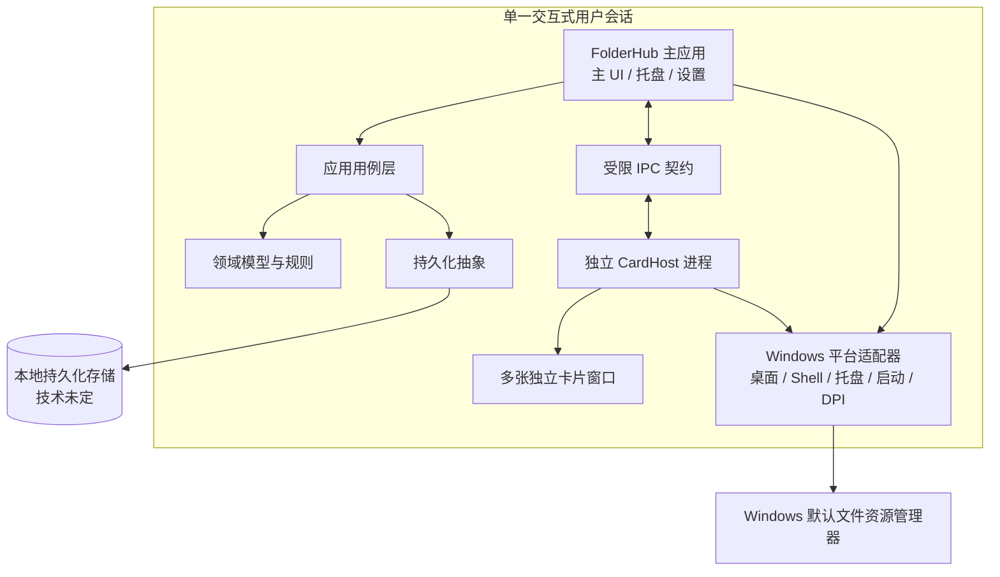

# FolderHub P3-02 总体架构候选方案与权衡分析

- 文档编号：FH-HLD-ARCH-002
- 版本：v0.2（追加 Q-015 用户选择及架构收敛）
- 日期：2026-11-20
- 工作流规范：software-predev-workflow-skill V2.6.1
- 阶段：P3_HIGH_LEVEL_DESIGN
- 状态：DRAFT / ANALYSIS（非设计基线）
- 输入需求基线：REQ-BL-1.0（SRS_FolderHub_v0.11.md）
- 关联任务：TASK-017、TASK-018
- 关联问题：Q-015（CLOSED / D2；用户选择 A，详见 CLQ-152 V3 / ADR-034）
- 关联风险：RISK-001（ACCEPTED；兼容性验证义务继续有效）

> 本文提供架构候选分析与收敛记录。用户已明确选择 CardHost 进程模型（ADR-034）；该选择不等于批准 IPC、数据库、运行时、Windows API、部署方式或完整 P3 设计基线。已批准的产品行为只作为约束；未验证技术结论均标记为 `NEEDS_VALIDATION`。

## 1. 执行摘要

### 1.1 当前分析结论

1. FolderHub 应采用**逻辑分层、模块化的 Windows 桌面应用架构**；领域规则、应用用例、持久化边界和 Windows 系统集成边界应分离，避免把业务规则绑定到某个 UI 框架或 Win32 API。
2. 为满足 ADR-021“主程序退出后独立卡片仍可显示”的已确认产品行为，用户已在 Q-015 / CLQ-152 明确选择：**一个交互式用户会话一个独立 CardHost 进程，由该进程承载该会话的全部独立卡片**。该选择已登记为 ADR-034；仅确认进程/宿主模型，不代表 IPC、存储、崩溃恢复、运行时或 Windows API 已选定。
3. Windows Service 不适合作为可见桌面卡片的直接宿主。微软文档说明服务自 Windows Vista 起不能直接与用户交互，服务运行于 Session 0；如需 UI，必须另起用户会话中的 GUI 进程。这会增加服务、会话代理、权限和 IPC 复杂度，而 FolderHub 当前明确是单用户交互式桌面产品。
4. UI 技术候选中，**WPF + Win32 互操作**值得作为优先验证的 UI 路线，但运行时必须单独比较。官方资料显示 .NET Framework 4.8 可用于 Windows 10 22H2，并可安装于 Server 2012/2012 R2/2016；现代 .NET 10/11 当前支持矩阵列出 Server 2012+，但 Windows 10 支持仅限 Enterprise/LTSC，且矩阵未列出 Windows 10 22H2。Windows App SDK 当前支持矩阵没有列出 Server 2012/2012 R2/2016，因此 WinUI 3 不适合作为覆盖全部已确认目标环境的统一首选。运行时取舍尚未定型。
5. “桌面壁纸层”不是简单的置顶窗口。桌面窗口层级、Explorer/桌面进程重启、多显示器和 DPI 恢复是高风险平台集成点，必须通过最小原型在目标系统实测；在验证前不得承诺某个 WorkerW/Progman 技巧具有跨版本稳定性。

### 1.2 本轮边界

- 不修改 REQ-BL-1.0、SRS v0.11、RAW、已确认 ADR、CR-001 或用户已接受的 RISK-001 状态。
- 已新增 ADR-034 记录用户选择的 CardHost 进程模型；其他技术选型 ADR 未创建。
- 不建立概要设计基线，不进入 P4。

## 2. 输入基线与不可变约束

| 来源 | 已确认约束 | 对架构的影响 |
|---|---|---|
| REQ-BL-1.0 / NFR-001 | Windows 10（22H2）/Windows 11（x64）本地交互式桌面；Windows Server 2012+ 单用户交互式桌面；Server 2012/2012 R2 为 Server with a GUI，2016+ 为 Desktop Experience；不支持 Server Core/RDS 多用户 | 所有技术路线必须以完整目标 OS 矩阵验证，不得用仅支持较新 Windows 的框架替代全范围验证 |
| ADR-001 / UIR-001 | 主组件显示于桌面壁纸层 | 必须有独立 Windows 桌面窗口集成边界；不能仅实现普通置顶窗口 |
| ADR-004 / ADR-012 | 默认托盘常驻；主组件默认隐藏；托盘提供打开主界面、设置、退出应用 | 主应用生命周期与主窗口显示状态分离；退出命令须定义清楚 |
| ADR-007 / FR-016 | 每个文件夹可单独开启独立卡片；显示图标、名称、用途说明；多个卡片可并存，各自移动和锁定；不依赖主组件显示 | 卡片呈现和位置状态应可独立管理，不能只作为主窗口子控件 |
| ADR-021 / FR-017 / BR-012 | 全局统一开关、默认开启；开启时主程序退出后卡片继续显示；关闭时全部卡片随主程序退出关闭 | 主程序与卡片宿主必须有可定义、可验证的生命周期边界；Q-015 尚待用户选择技术实现 |
| ADR-020 / FR-011 | 主组件列表和独立卡片双击打开文件夹；单击选中；右键菜单提供打开；调用 Windows 默认文件资源管理器 | 需要统一 Shell 打开适配器和路径异常处理 |
| ADR-028 / FR-018 | 同一实际路径只保留一条记录；路径等价判定算法待设计 | 路径规范化属于领域/基础设施边界，不能散落在 UI |
| ADR-033 / FR-019 / NFR-002 | 显示器/DPI/分辨率变化时保持可见性，必要时迁移到主显示器可见区域；位置和锁定跨重启保存 | 需要统一坐标/显示器适配器及持久化状态模型 |
| RISK-001 | Server 兼容性风险状态 ACCEPTED；逐版本验证义务未解除 | 技术选型前建立兼容性矩阵；失败时按 CR 流程，不擅自缩减目标范围 |

## 3. 总体架构候选方案

### 3.1 候选 A：单进程模块化桌面应用

主窗口、托盘、独立卡片和业务模块均在同一应用进程中；主窗口关闭后进程可继续驻留后台。

**优点**
- 进程和部署结构最简单；无需跨进程通信。
- 共享内存状态和数据访问简单，调试、打包、升级成本较低。
- 多张卡片可由同一窗口管理模块统一创建和恢复。

**缺点/风险**
- 若“退出主程序”意味着主应用进程真正终止，则卡片也会随进程终止，无法满足 FR-017。
- 若为了保留卡片而让进程持续驻留，实际语义变成“关闭主窗口但应用后台仍运行”；需要确认这是否符合用户已确认的“退出主程序”行为。
- 单进程崩溃会同时关闭主组件、托盘和全部卡片，故障隔离较弱。

**适用条件**：仅当用户确认“退出主程序”实际允许主应用进程继续后台运行时才可采用。当前不作为首选，因为它对 FR-017 的解释存在语义风险。

### 3.2 候选 B：模块化主应用 + 每用户会话一个独立 CardHost 进程

主应用负责配置、分类/文件夹管理、搜索、设置和托盘；CardHost.exe 在同一交互式用户会话中独立运行，承载该会话的所有卡片窗口。主应用退出时根据全局开关向 CardHost 发送保留/关闭指令。主应用重新启动后可重新连接正在运行的 CardHost。

**优点**
- 可直接表达“主应用进程退出、独立卡片继续显示”，最贴合 ADR-021 / FR-017。
- 单会话一个宿主，进程数量固定，不随卡片数量线性增长。
- 主应用和卡片窗口故障隔离；主 UI 退出或重启不必关闭卡片。
- CardHost 可以只暴露受限 IPC 契约，不需要运行 Windows 服务或提升权限。
- 多卡片位置/锁定状态可由同一宿主统一恢复。

**缺点/风险**
- 需要设计 IPC、身份验证/ACL、协议版本兼容、主应用重连和状态同步。
- 必须定义 CardHost 异常退出、崩溃后重启、升级替换、残留进程和退出竞态。
- 主应用与 CardHost 对持久化数据的读写边界必须清晰，避免并发写入和状态分叉。
- 需验证同一用户会话内的窗口桌面层级、Explorer 重启、多显示器和 DPI 行为。

**适用条件**：用户选择“主应用进程可以真正退出、卡片仍要显示”这一已确认产品语义。当前推荐作为 Q-015 首选候选，但仍需原型验证。

### 3.3 候选 C：每张独立卡片一个独立进程

每张卡片由单独的 Card.exe 进程承载；主应用负责创建、管理和更新卡片进程。

**优点**
- 单张卡片崩溃时理论上可隔离其他卡片。
- 单卡片可独立升级/重启/诊断，进程级资源隔离更明确。
- 主应用退出后各卡片可独立存活。

**缺点/风险**
- 进程数随卡片数增长，增加内存、启动、句柄、窗口管理和系统资源开销。
- 多卡片状态恢复、统一退出、配置变更广播、版本升级和残留进程清理更复杂。
- 同一套业务/显示代码需要处理多进程并发和协议兼容，开发测试成本最高。
- 单卡片进程数量不受需求限制，缺少明确性能预算，无法证明该复杂度合理。

**适用条件**：只有在后续验证证明单宿主隔离不足、且确有单卡片独立崩溃/资源隔离需求时再考虑。当前不推荐。

### 3.4 候选 D：Windows Service + 用户会话 GUI Agent

Windows Service 作为后台协调者，用户会话中另启 GUI Agent 展示卡片；Service 本身不直接创建桌面窗口。

**优点**
- 后台协调能力可独立于普通用户界面进程。
- 可使用系统服务生命周期和服务恢复机制承载真正需要机器级运行的后台任务。

**缺点/风险**
- 微软文档明确指出，自 Windows Vista 起服务不能直接与用户交互；服务运行于 Session 0。若要显示 UI，必须另建用户会话 GUI 进程。
- 需要服务安装/卸载、管理员权限、服务账户、用户会话代理、跨会话安全和 IPC，显著增加部署和安全面。
- FolderHub 当前排除 RDS 多用户，且没有机器级后台任务需求，Service 的收益不足以抵消复杂度。
- 若误将卡片 UI 放在 Service 中，会遇到会话隔离与桌面不可见问题。

**适用条件**：未来出现明确的机器级后台服务需求时再重新评估。当前不推荐作为卡片宿主。

### 3.5 总体架构比较

| 评价维度 | A 单进程驻留 | B 单 CardHost/用户会话 | C 每卡片进程 | D Service + GUI Agent |
|---|---|---|---|---|
| 主应用真正退出后卡片继续显示 | 不满足，除非主进程不退出 | 满足 | 满足 | 可满足但需 GUI Agent |
| 进程数量/资源 | 最低 | 低且固定 | 随卡片数增长 | 多组件、较高 |
| 故障隔离 | 低 | 中高 | 高 | 组件多，隔离复杂 |
| IPC/同步复杂度 | 低 | 中 | 高 | 很高 |
| 部署/维护复杂度 | 低 | 中 | 高 | 很高 |
| 单用户桌面适配 | 好 | 好 | 可行 | 过度设计 |
| 与已确认 FR-017 的语义匹配 | 有歧义 | 高 | 高 | 中高 |
| 当前建议 | 条件性备选 | **推荐候选** | 暂不推荐 | 不推荐 |

**推荐结论（ASSISTANT_SUGGESTION）**：候选 B。采用一个用户会话级 CardHost，管理该会话全部独立卡片；主应用作为管理端，允许独立退出。此推荐不构成用户决定，最终以 Q-015 回答和后续验证为准。

## 4. 建议的逻辑模块边界

以下是与具体进程部署无关的逻辑模块建议。即使 Q-015 最终选择不同宿主方案，领域和应用层边界仍可保留。

| 模块 | 主要职责 | 不应承担的职责 | 需求追踪 |
|---|---|---|---|
| Domain / 领域模型 | Category、FolderEntry、分类关联、卡片配置、全局设置等业务实体与规则；路径唯一性规则的抽象 | UI 控件、Win32 API、数据库细节 | FR-001～FR-006、FR-018、BR-001～BR-012 |
| Application / 用例层 | 分类/文件夹 CRUD、排序、搜索、固定/取消固定、位置锁定、全局退出设置、打开文件夹等用例编排 | 直接操作 HWND、注册表或数据库 | FR-001～FR-019、BR-001～BR-012 |
| Persistence / 持久化边界 | 通过 Repository/Store 接口保存业务数据、全局设置、主组件和卡片位置/锁定状态；支持版本迁移与备份策略的后续设计 | UI 状态和窗口句柄 | NFR-002、FR-018、FR-019 |
| Main UI / 主组件 | 主界面、分类导航、文件夹列表、搜索、编辑表单、设置面板 | 持有独立卡片的唯一生命周期 | UIR-001/002、FR-001～FR-015 |
| Tray & Startup Adapter | 系统托盘、启动配置、托盘命令转发 | 业务规则和卡片窗口绘制 | FR-012、FR-013 |
| Windows Desktop Adapter | 桌面窗口层级、无激活/窗口样式、透明背景、位置/锁定、显示器/DPI 信息 | 业务实体持久化 | ADR-001、FR-014～FR-017、FR-019、NFR-004 |
| Shell / Folder Adapter | 路径可访问性检查、调用默认资源管理器打开目录、拖拽入口适配 | 决定记录是否因路径失效而删除 | FR-009～FR-011、FR-018、BR-009/010 |
| CardHost Runtime | 管理独立卡片窗口集合、卡片位置恢复、宿主生命周期和异常状态 | 管理主组件全部业务 UI | FR-016、FR-017、FR-019、NFR-002 |
| IPC Contract | 主应用与 CardHost 的启动、连接、状态同步、创建/更新/关闭卡片、版本协商和错误响应 | 直接暴露数据库内部结构 | FR-016、FR-017、NFR-002（架构候选） |
| Diagnostics | 结构化日志、启动/退出原因、IPC 连接、窗口恢复/迁移失败记录 | 自动删除用户数据或掩盖错误 | NFR-001～NFR-003 的验证支持（推导建议） |

### 4.1 逻辑组件关系（候选 B）

> 此图是逻辑和候选进程视图，不是批准的部署架构。IPC 协议、持久化并发策略、CardHost 崩溃恢复及窗口层级仍需后续验证。

## 5. Windows 桌面集成方式比较

### 5.1 桌面壁纸层主组件与独立卡片

- 需求要求桌面壁纸层，不等同于普通 TopMost 置顶窗口。
- 技术上需要一个 Windows Desktop Adapter，将 UI 框架创建的顶层窗口句柄与窗口样式、Z-order、无激活行为、透明背景、显示器/DPI 位置管理封装起来。
- 通过 Progman/WorkerW 等桌面窗口层级技巧实现壁纸层嵌入的做法，在本次查阅的公开微软文档中未找到对其作为第三方应用稳定扩展点的跨版本兼容承诺。因此将其标记为高风险 `NEEDS_VALIDATION`，不能把网络示例或单一系统版本实测外推到 Server 2012+ 全范围。
- 验证必须覆盖 Explorer 重启、桌面图标层级、任务栏/全屏窗口、锁屏/解锁、显示器热插拔、分辨率/DPI 变化和 RDP 会话重连（目标范围内适用）。
- 若壁纸层实现无法在某个已确认目标版本稳定工作，不得擅自降级为普通置顶窗口或删除该目标系统；应记录验证失败并提交影响分析/CR 供用户决策。

### 5.2 托盘与开机启动

- 托盘图标、菜单和主界面唤醒应封装为 Tray Adapter；托盘菜单只发出应用用例命令，不直接操作领域数据。
- 开机启动按当前单用户交互式桌面范围，优先评估用户级启动入口（例如 HKCU Run 或当前用户 Startup 文件夹），避免未经需求授权就要求管理员权限或安装 Windows Service。
- 实际选择需比较启动顺序、用户可见开关、卸载清理、路径变更、权限和 Server GUI 行为；当前不选定具体注册方式。

### 5.3 文件夹打开与拖拽

- 打开目录通过 Shell Adapter 调用 Windows Shell 默认文件资源管理器；微软 ShellExecute 文档明确支持对目录使用 `open` / `explore` 操作。路径检查与错误提示由应用层负责，真实目录不由 FolderHub 删除。
- 资源管理器拖拽入口通过独立适配器处理，避免将 OLE/拖放事件直接写入业务模型。
- 具体 API、Unicode 路径、UNC/网络路径、权限拒绝和路径失效场景须在目标系统验证。

### 5.4 多显示器、DPI 与窗口状态

- 统一建立逻辑坐标/物理像素转换边界，保存组件所属显示器标识、位置和必要的窗口状态信息；具体字段和算法留待数据设计。
- 主组件与每张独立卡片分别执行 FR-019 的可见性判断和迁移规则。
- 不把 WPF/WinUI 的 UI 布局坐标直接等同于 Win32 物理像素坐标；需明确 DPI awareness 模式及跨显示器缩放策略。

## 6. UI 框架与技术候选

| 候选 | 优点 | 限制/风险 | 与目标 OS 的初步判断 |
|---|---|---|---|
| WPF + .NET Framework 4.8 | Windows 桌面成熟；XAML 数据绑定/样式适合主界面和卡片；可通过 HWND/PInvoke 与 Win32 桌面 API 集成；官方系统要求列出 Win10 22H2 和 Server 2012/2012 R2/2016 可安装 | 运行时较旧；Framework 4.8 支持遵循父 OS 生命周期；依赖/库版本和现代工具链要核对 | **目前公开安装矩阵中最直接覆盖 Win10 22H2 + Server 2012+ 的 WPF 运行时候选**；仍需实际部署验证，且不代表这些旧 OS 仍受微软安全支持 |
| WPF + 现代 .NET 10/11 | 现代运行时、长期维护路径较好；WPF Desktop Runtime 可用；便于采用现代 .NET 库 | 当前 .NET 支持表虽列 Server 2012+，但 Windows 10 支持限 Enterprise/LTSC，未列 Win10 22H2；若目标 Windows 10 SKU 不满足则存在官方支持缺口 | 可作为现代化候选；需先核对 Win10 22H2 SKU/服务通道与部署实测，不能先认定覆盖全矩阵 |
| WinUI 3 + Windows App SDK | 微软推荐的新 Windows 桌面 UI；Fluent Design、现代控件和 Windows App SDK 功能 | Windows App SDK 的 Server 支持矩阵当前只列 Server 2019/2022 等，不列 Server 2012/2012 R2/2016；若全范围兼容性是硬约束则存在直接冲突 | 不建议作为全目标 OS 的统一 UI 框架；可作为仅新系统的独立候选，但会造成多技术路线 |
| 原生 Win32 / C++ | 对窗口、消息循环、Shell、托盘和低层 API 控制最直接；依赖较少，旧系统适配空间大 | UI 业务开发、数据绑定、复杂列表/表单和可访问性成本高；维护门槛较高 | 兼容性潜力高，但需验证工具链、编译目标和开发成本；`NEEDS_VALIDATION` |
| Avalonia + 现代 .NET | UI 迭代与跨平台抽象能力较强；可把 Windows 系统集成留在平台适配层 | 桌面壁纸层、托盘、窗口层级和 DPI 仍需 Win32 互操作；Server 2012 支持与发布组合需实测 | 可作备选验证，不因跨平台能力推断兼容；`NEEDS_VALIDATION` |
| Electron / WebView 容器 | 可复用部分网页 UI 经验；前端迭代快 | Chromium/WebView 运行时、内存占用、安装包体积、旧 Server 支持和原生桌面层集成风险较高 | 当前不推荐作为首版统一路线；需先证明 Server 2012 运行时可行性 |

**初步推荐（ASSISTANT_SUGGESTION）**：优先选择 WPF 作为 UI 框架候选，运行时并列验证 .NET Framework 4.8 与现代 .NET 10/11；以原生 Win32/C++ 作为低层能力或兼容性对照候选。当前不批准任何运行时版本；暂不采用 WinUI 3 作为覆盖全部目标环境的统一框架。

### 6.1 当前官方资料核验结论

- 微软将 WinUI 3 定位为新的原生 Windows 桌面 UI 框架，但 Windows App SDK 支持矩阵列出的 Server 版本从 Server 2019/2022 起，不包括 FolderHub 已确认的 Server 2012/2012 R2/2016。
- .NET Framework 4.8 官方系统要求列出 Windows 10 22H2，并允许安装于 Windows Server 2012/2012 R2/2016；但 Framework 4.8 的支持遵循父操作系统生命周期，不能把“可安装”理解为旧 OS 仍获得微软支持。
- 现代 .NET 10/11 当前支持表列出 Server 2012、2012 R2、2016 等版本；同时明确 Windows 10 支持限于 Enterprise/LTSC，表中未列出 Windows 10 22H2。现代 .NET 路线因此不能仅凭 Server 兼容性推断满足 FolderHub 全目标矩阵。
- .NET Desktop Runtime 提供 WPF 桌面运行时；需将 WPF UI 框架与运行时版本拆开决策。

### 6.2 同类开源项目轻量调研（ADR-016）

本轮对 8 个 GitHub 项目进行公开资料级轻量调研。项目用途并不完全相同，分为桌面分组/文件夹组件、桌面层/壁纸集成、桌面 Shell 组织三类。公开 README、目录结构、技术栈和许可证信息仅作为架构参考，不等同于源码级审计、实机验证或技术选型。

| 项目 | 公开技术栈/结构 | 可借鉴点 | 与 FolderHub 的差异/风险 | 许可/维护观察 |
|---|---|---|---|---|
| [kof2000git/desktop_box](https://github.com/kof2000git/desktop_box) | C# / WPF / .NET 8；MVVM；Shell32/User32 P/Invoke；另有 C++ ShellMenu helper；桌面层透明子 HWND | WPF + Win32 Adapter；将第三方 Shell ContextMenu 放入独立辅助进程隔离崩溃；路径引用而非移动文件 | 目标是桌面文件分组，不是 FolderHub 的分类/独立文件夹卡片；公开资料未证明 Server 2012+ 兼容 | MIT；GitHub 页面显示 75 commits、13 stars；最后提交日期本次页面未能可靠读取 |
| [xuwenze2006-sketch/DesktopOrganizer](https://github.com/xuwenze2006-sketch/DesktopOrganizer) | .NET 10 + WPF；本地优先；有 App/Desktop/Layout/Persistence/ShellInterop 等职责分区与测试 | 模块按职责拆分；数据本地持久化；明确把自动测试与桌面实机验证区分 | 面向 Windows 10/11；预览版；个人维护项目；操作范围包含真实文件系统动作，与 FolderHub 仅维护路径记录不同 | MIT（素材另有许可）；页面显示 0 stars/0 forks；项目说明有预览版本，维护规模较小 |
| [Tianyu199509/DeskBox](https://github.com/Tianyu199509/DeskBox) | C# / WinUI 3 / .NET 10 Native AOT / Windows App SDK + Rust Shell layer | 原生 Shell 层与 UI 分层；本地优先；真实文件夹映射到桌面组件 | 明确面向 Windows 10/11；WinUI 3 / Windows App SDK 对 Server 2012/2012 R2/2016 支持矩阵缺口；GPL-3.0-only 不适合未经许可审查直接复用代码 | GPL-3.0-only；公开页面显示 8.3k stars、450 forks，具备较高关注度；版本/活跃度仍需按具体提交复核 |
| [Station1921/DynamicWallpaper](https://github.com/Station1921/DynamicWallpaper) | C# / .NET 8 / WPF + WinForms 托盘；WorkerW；可选 WebView2 独立模块 | WPF 桌面层集成、托盘、Explorer 重启/显示器热插拔后恢复；将 WebView2 设为可选程序集 | 目标构建说明为 Windows 10/11；主功能是动态壁纸而非文件夹卡片；WorkerW 仍属需逐版本验证的实现路径 | GitHub 页面显示 203 commits、1 star；本轮页面未见明确许可证声明，复用代码前必须核验 LICENSE |
| [Felix-au/DeskX-Wallpaper-Engine](https://github.com/Felix-au/DeskX-Wallpaper-Engine) | Electron 34 / Node.js；koffi Win32 FFI；electron-store；主进程 + IPC + 每显示器渲染进程；WorkerW 和三层 Z-order | 明确区分设置窗口、壁纸渲染和多个叠加层；IPC 桥接；多显示器分层管理 | Chromium/Electron 运行时与内存成本较高；需独立核验旧 Server OS；README 暴露外部天气/内容 API，不适合作为 FolderHub 本地优先架构的直接模板 | 仓库包含 LICENSE 文件，但本轮未核实许可文本；未核实前禁止复制代码 |
| [saintose1/DesktopOrganizer](https://github.com/saintose1/DesktopOrganizer) | WPF / .NET；Shell/Explorer 图标组织；测试项目；HKCU Run 用户级启动 | 直接使用 Explorer 真实图标的路线；退出时恢复 Explorer 状态；用户级启动；对异常恢复和卸载恢复的关注 | 明确 Windows 10/11；它不使用 DLL 注入/普通 overlay，而是操作 Explorer 图标显示；这与 FolderHub 的文件夹卡片视图不同 | MIT；页面显示 18 commits、2 stars；最后提交日期未从当前页面确认 |
| [Nishikinonakai/MacDesk](https://github.com/Nishikinonakai/MacDesk) | .NET 10 / WPF；DesktopLayer；多显示器协调；Watchdog；独立 Shell 菜单 helper；布局备份 | Explorer/主进程异常后的 Watchdog；显示器变化的进程交接；把不稳定 Shell 扩展隔离到子进程 | 作者公开说明当前验证环境为 Windows 11；桌面层透明合成、DPI 重挂载存在已知约束；不能据此推断 Server 2012 兼容 | MIT；页面显示项目结构和开发说明；本次抓取未独立核实提交频率 |
| [serkanyardim/padx](https://github.com/serkanyardim/padx) | WPF；Paddock.App / Core / Shell 三层；P/Invoke、COM、Shell；xUnit 测试 | 清晰分离 UI、纯核心逻辑和 Windows Shell；位置/配置保存；桌面分组和透明度交互 | 要求 Windows 10 1903+ / Windows 11；主要整理桌面真实图标，不等同于 FolderHub 的任意路径登记和独立卡片 | MIT（基于 MIT 的 Paddock）；页面显示 83 commits、0 stars；最后提交日期未从当前页面确认 |

#### 6.2.1 调研归纳

1. **WPF + Win32/Shell 互操作是现实存在的工程路线**：DesktopBox、MacDesk、padx、DynamicWallpaper 均提供了相关实现样例；但项目公开目标大多为 Windows 10/11，不能代替 Server 2012+ 兼容性实测。
2. **平台适配应独立成层**：多项目把 Shell/Win32/桌面层封装为独立模块；FolderHub 应避免让 Domain/Application 直接引用 HWND、COM 或 WorkerW。
3. **进程隔离有实际价值**：DesktopBox/MacDesk 把 Shell 菜单或 Watchdog 相关能力隔离；这支持我们对 CardHost/辅助进程进行评估，但并不能直接证明 CardHost 方案已经适合 FolderHub。
4. **桌面层技术具有较强环境依赖**：WorkerW、SHELLDLL_DefView、Explorer 恢复、混合 DPI 和多显示器切换均需真实 Windows 验证；不同项目的技术实现和失败回退并不相同。
5. **WinUI 3 的现代化优势不能覆盖旧 Server 兼容性缺口**：DeskBox 可作为 WinUI 3 的架构参考，但其目标是 Windows 10/11，不符合 FolderHub 的 Server 2012+ 全范围目标。
6. **许可必须逐仓库处理**：MIT 项目可进一步做代码级审查；GPL-3.0-only 项目只能先作架构参考，若计划复用或分发其代码需先进行许可影响审查；未查清 LICENSE 的仓库不得复制代码。
7. GitHub Stars/commits 只作为公开活跃度的弱指标，不代表质量、兼容性或可维护性。当前页面未暴露的最后提交日期均标记为未核实，不作推断。

**对 FolderHub 的影响**：保留 WPF + Win32 Adapter（运行时在 .NET Framework 4.8 与现代 .NET 10/11 间验证）为优先验证候选；桌面层/Explorer 恢复需单独建立最小原型；同类项目不作为直接代码依赖，不将其 OS 支持声明迁移为 FolderHub 的兼容性结论。

## 7. Q-015 独立卡片宿主生命周期专项分析

### 7.1 已确认产品行为（不可改变）

- 每个文件夹可独立启用卡片；多卡片同时存在；每张卡片独立位置和锁定。
- 全局统一“主程序退出后是否保留卡片”开关，默认开启。
- 开启：主程序退出后，已创建卡片继续显示。
- 关闭：主程序退出后，所有独立卡片一并关闭。
- 不提供逐卡片覆盖开关。

以上来自 Q-010 / ADR-021 / FR-016 / FR-017 / BR-012。Q-015 只处理技术宿主生命周期，不重新讨论产品行为。

### 7.2 宿主候选比较

| 选项 | 方案 | 主要收益 | 主要代价/风险 | 推荐 |
|---|---|---|---|---|
| A | 一个独立 CardHost 进程承载同一用户会话的全部卡片 | 主应用可真正退出；进程数量固定；故障隔离较好；可集中恢复多卡片 | IPC、状态同步、宿主崩溃恢复和升级需设计 | **推荐** |
| B | 主应用窗口关闭，但主应用进程继续后台驻留并托管卡片 | 最简单；无 IPC；资源共享直接 | 实际并未退出主进程；与“退出应用”语义可能冲突；主进程崩溃会关闭全部卡片 | 仅在用户确认允许后台驻留时适用 |
| C | 每张卡片一个独立进程 | 单卡片故障隔离较强 | 进程数量随卡片增长；资源、同步、更新和清理复杂 | 不推荐 |
| D | Windows Service 协调 + 用户会话 GUI Agent | 服务可承担机器级后台任务 | Session 0/交互限制、安装权限、安全面和部署复杂度高；当前没有机器级服务需求 | 不推荐 |
| E | 其他 | 可提出不同宿主/进程模型 | 需补充具体行为、部署、恢复与安全边界 | 待用户补充 |

### 7.3 推荐候选 A 的生命周期草图（尚未批准）

1. 用户登录并按配置启动 FolderHub 主应用；主应用加载已保存的卡片配置。
2. 主应用检查当前用户会话是否已有 CardHost；不存在时启动一个 CardHost，并通过受限 IPC 建立连接。
3. 主应用发送卡片配置快照/增量变更；CardHost 创建、更新和关闭卡片窗口。位置/锁定状态按 NFR-002 持久化。
4. 用户执行“退出应用”时：若全局保留开关开启，主应用通知 CardHost 进入独立驻留状态并退出；若关闭，则通知 CardHost 关闭全部卡片后退出。
5. 用户重新启动主应用时，主应用重新连接现有 CardHost 并同步状态；若宿主不存在，则根据已保存配置恢复。
6. Windows 用户注销/关机时，用户会话结束，CardHost 随会话结束；下次登录后的恢复由启动流程和持久化状态完成。当前需求没有要求卡片跨用户注销继续运行。

**尚未解决的异常边界**：CardHost 在主应用退出期间崩溃时，谁负责即时重启？若没有常驻监督者，卡片可能直到用户重新打开主应用才恢复。是否需要独立 Supervisor、任务计划触发或其他恢复机制，须根据可靠性收益和复杂度继续分析；不得擅自加入 Windows Service。

### 7.4 必须验证的宿主行为

- 主应用正常退出、主窗口隐藏、托盘退出、系统关机/注销分别触发何种宿主行为。
- 全局开关开启/关闭的行为与 ADR-021 完全一致。
- 主应用重启后能重新发现并连接 CardHost；重复启动不会产生多个宿主或重复卡片。
- CardHost 异常退出、无响应、IPC 断开、版本不匹配、数据读取失败时的恢复和提示。
- CardHost 退出竞态、主应用同时关闭/重启、卡片增删改时的一致性。
- 多卡片位置、锁定状态和透明度/显示设置在进程重启后正确恢复。
- 用户会话、权限、UAC、RDP 断开/重连和 Explorer 重启行为。

## 8. 数据、IPC 与部署边界（本阶段仅定义逻辑约束）

- 不指定 SQLite、JSON 或其他数据库；持久化模块只暴露仓储/配置接口。
- 建议主应用作为业务数据的主要写入者，CardHost 消费必要的卡片配置/状态快照；是否允许 CardHost 写回位置状态，需在数据并发设计中明确。
- IPC 应限定在同一用户会话和用户身份；需有命令白名单、消息版本、超时、错误码和连接恢复机制。具体采用 Named Pipes 或其他机制待验证。
- 主应用和 CardHost 均以普通用户权限运行；当前没有提升权限的需求。不要把 UI 宿主放入 LocalSystem 服务。
- 部署包应保证主应用与 CardHost 版本一致；升级时先关闭/迁移旧宿主，再启动新版本，具体升级流程留待 P4。

## 9. 关键风险与验证计划

| 编号 | 风险/未知项 | 当前判断 | 验证动作 | 通过标准 |
|---|---|---|---|---|
| V-01 | 壁纸层/桌面窗口层级跨版本稳定性 | 高风险 / NEEDS_VALIDATION | 最小 HWND 原型，在 Windows 10/11 与 Server 2012/2012 R2/2016+ GUI 环境验证 | 主组件和独立卡片处于需求指定桌面层级；Explorer 重启后可恢复；不影响桌面图标/任务栏基本交互 |
| V-02 | WPF 运行时覆盖目标 OS | NEEDS_VALIDATION | 并列验证 .NET Framework 4.8 与现代 .NET 10/11；核对 Desktop Runtime 支持矩阵、Windows 10 22H2 SKU、Server 2012+ 安装前置依赖 | 明确每个目标 OS 的支持状态；所有目标 OS 均可安装/启动/绘制窗口；无缺失 API；依赖和部署方式可接受 |
| V-03 | WinUI 3 / Windows App SDK Server 支持缺口 | 当前资料显示不满足完整 Server 目标矩阵 | 保留为对照，不作为首版统一选型；若重新考虑须先证明 2012/2012 R2/2016 可行 | 逐版本证据满足 NFR-001 |
| V-04 | CardHost IPC 和进程生命周期 | NEEDS_VALIDATION | 构建双进程最小原型，测试启动/连接/主程序退出/重连/关闭/异常退出 | 满足 ADR-021；无重复宿主/卡片；状态一致且失败可诊断 |
| V-05 | CardHost 崩溃恢复 | NEEDS_VALIDATION | 模拟主应用已退出时 CardHost 崩溃，比较无 Supervisor 与带轻量 Supervisor 的恢复行为 | 明确恢复时间/用户反馈/资源代价；不引入未批准的服务架构 |
| V-06 | 多显示器/DPI 坐标恢复 | NEEDS_VALIDATION | 覆盖显示器增减/断开、排列、分辨率和 DPI 变化 | 符合 FR-019，主组件和每张卡片分别保持可见 |
| V-07 | Server 兼容性 | RISK-001 / ACCEPTED，验证未完成 | 建立 Windows Server 2012/2012 R2/2016/2019/2022+ 实机/虚拟机矩阵；记录 GUI/Desktop Experience 形态 | 逐版本通过需求验收；未测试项明确 NOT_CHECKED，不以抽样代替全矩阵 |

## 10. 需求—模块追踪（初稿）

| 需求 | 主要逻辑模块 | Windows 集成边界 | 验证重点 |
|---|---|---|---|
| FR-001～FR-006、BR-001～BR-007 | Domain、Application、Main UI、Persistence | 文件/目录选择器与拖拽 Adapter | CRUD、多分类、分类内排序、删除登记不删磁盘目录 |
| FR-007、BR-008 | Search Use Case、Main UI | 无强制特殊 API | 名称/别名动态搜索、跨分类去重 |
| FR-008、BR-011 | Domain、Main UI、CardHost UI | UI 文本测量/截断 | 主界面和卡片均展示用途说明 |
| FR-009 | Application、Shell Adapter | Explorer OLE Drag & Drop | 拖入目录建立记录，错误可见 |
| FR-010、BR-009/010 | Application、Shell Adapter | 文件系统访问 | 路径异常保留记录、重新指定后可打开 |
| FR-011 | Application、Shell Adapter | Windows Shell | 双击/右键调用默认 Explorer |
| FR-012、FR-013 | Tray/Startup Adapter | 系统托盘、用户登录启动入口 | 开关、托盘菜单、启动/退出行为 |
| FR-014、FR-015、UIR-001/002 | Main UI、Windows Desktop Adapter | HWND/Z-order/透明窗口/位置 | 桌面层级、移动/锁定、背景透明和文字可读性 |
| FR-016、FR-017、BR-012 | CardHost Runtime、IPC、Persistence | 独立顶层窗口及进程生命周期 | 多卡片、独立位置/锁定、主应用退出后的保留开关 |
| FR-018 | Domain、Path Identity Service、Persistence | 文件系统路径规范化 | 同一路径唯一性及别名/网络路径边界 |
| FR-019、NFR-002 | Display Adapter、Window State Store、CardHost | 显示器/DPI/坐标 API | 组件逐个可见性判断、迁移、重启恢复 |
| NFR-001 | Platform Adapter、Deployment/Compatibility | 各版本 Windows 桌面/Shell | 逐版本兼容性矩阵，当前不得标 PASS |
| NFR-003 | Domain、Persistence、Shell Adapter | 文件系统 | 删除登记与真实目录删除严格分离 |
| NFR-004 | UI Rendering、Desktop Adapter | 分层窗口透明度 | 仅背景透明，文字/图标不透明 |

## 11. 方案推荐与当前未决项

### 11.1 推荐候选（均非用户批准）

- 总体结构：模块化 Windows 桌面应用；逻辑层分离，平台能力通过 Adapter 注入。
- 卡片宿主：一个用户会话一个 CardHost 进程（Q-015 选项 A）。
- UI 框架：优先验证 WPF；运行时并列验证 .NET Framework 4.8 与现代 .NET 10/11；Win32 互操作封装桌面层级、托盘、Shell、DPI 等平台能力；保留原生 Win32 对照验证。
- Windows Service：不用于可见卡片宿主。
- 持久化/IPC/安装升级：保持抽象，不在本文件定型。

### 11.2 仍未决 / NEEDS_VALIDATION

1. Q-015：用户已选择 A；宿主进程模型确认，其他实现细节仍未定。
2. UI 框架：尚未进行可运行原型验证，当前推荐不是技术批准。
3. 桌面壁纸层：缺少全目标 OS 兼容证据。
4. Windows 10 22H2 的 SKU/服务通道及当前 .NET 支持矩阵适用性需核验。
5. CardHost 崩溃后的即时恢复机制和是否需要 Supervisor 未定。
6. IPC、持久化、数据库、数据迁移、备份恢复和升级方案未定。
7. RISK-001 仍 ACCEPTED，不代表兼容性通过。

## 12. 质量自检

| 检查项 | 结果 | 说明 |
|---|---|---|
| 输入基线和约束可追踪 | PASS | 以 REQ-BL-1.0 / SRS v0.11 为输入；未修改需求 |
| 总体架构候选比较 | PASS（分析层） | 比较单进程、独立宿主、每卡片进程、Service + GUI Agent |
| 模块边界与职责 | PASS（逻辑层） | 已建立 Domain/Application/Persistence/UI/Platform/CardHost/IPC 等边界 |
| Q-015 退出语义和候选分析 | PASS（选择已确认） | 用户选择 A，新增 ADR-034；其他实现细节继续验证 |
| 同类项目轻量调研 | PASS（公开资料层） | 按 ADR-016 对 8 个 GitHub 项目进行技术栈/架构/许可/活跃度初筛；未做源码级审计或代码复用 |
| Windows 桌面集成可行性 | NEEDS_VALIDATION | 壁纸层、托盘、DPI、Explorer 重启等尚未实机验证 |
| UI 框架兼容性 | NEEDS_VALIDATION | WPF 为优先验证候选；WinUI 3 与旧 Server 目标矩阵存在支持缺口 |
| 需求/决策基线保护 | PASS | 未修改 SRS、RAW、既有 ADR-001～ADR-033、CR-001；仅新增 ADR-034 记录用户选择 |
| RISK-001 状态 | PASS（保护） | 仍 ACCEPTED；验证义务保留 |
| Git Commit/Tag | NOT_CHECKED | 当前环境未连接可验证项目 Git 仓库 |

**结论（v0.2）：** P3-02 架构候选与模块边界分析草案已形成；Q-015 的宿主/进程模型选择已由用户确认 A 并记录为 ADR-034。IPC、持久化、故障恢复、运行时和 Windows 桌面集成仍待设计/验证；P3 继续 `IN_PROGRESS`，P4 保持 `NOT_STARTED`，概要设计基线未建立。

## 13. 参考资料

1. Microsoft Learn — .NET Framework system requirements：<https://learn.microsoft.com/dotnet/framework/get-started/system-requirements>
2. Microsoft Learn — modern .NET supported Windows versions：<https://learn.microsoft.com/en-us/dotnet/core/install/windows>
3. Microsoft Learn — WinUI 3：<https://learn.microsoft.com/en-us/windows/apps/winui>
4. Microsoft Learn — Windows App SDK supported Windows releases：<https://learn.microsoft.com/en-us/windows/apps/windows-app-sdk/support>
5. Microsoft Learn — Install .NET on Windows / supported Windows versions：<https://learn.microsoft.com/en-us/dotnet/core/install/windows>
6. Microsoft Learn — WPF overview：<https://learn.microsoft.com/en-us/dotnet/desktop/wpf/overview>
7. Microsoft Learn — Interactive Services：<https://learn.microsoft.com/en-us/windows/win32/services/interactive-services>
8. Microsoft Learn — ShellExecuteW：<https://learn.microsoft.com/en-us/windows/win32/api/shellapi/nf-shellapi-shellexecutew>
9. Microsoft Learn — Run and RunOnce Registry Keys：<https://learn.microsoft.com/en-us/windows/win32/setupapi/run-and-runonce-registry-keys>
10. Microsoft Learn — Choose your interop approach for Windows apps：<https://learn.microsoft.com/en-us/windows/apps/develop/interop/>
11. GitHub — DesktopBox（WPF + C++ Shell helper）：<https://github.com/kof2000git/desktop_box>
12. GitHub — DesktopOrganizer（.NET 10 + WPF）：<https://github.com/xuwenze2006-sketch/DesktopOrganizer>
13. GitHub — DeskBox（WinUI 3 + Rust Shell layer）：<https://github.com/Tianyu199509/DeskBox>
14. GitHub — DynamicWallpaper（WPF + WorkerW）：<https://github.com/Station1921/DynamicWallpaper>
15. GitHub — DeskX Wallpaper Engine（Electron + Win32 FFI + IPC）：<https://github.com/Felix-au/DeskX-Wallpaper-Engine>
16. GitHub — DesktopOrganizer（Explorer/Shell icon groups）：<https://github.com/saintose1/DesktopOrganizer>
17. GitHub — MacDesk（WPF + Watchdog + DesktopLayer）：<https://github.com/Nishikinonakai/MacDesk>
18. GitHub — padx（WPF App/Core/Shell 分层）：<https://github.com/serkanyardim/padx>

## 14. 修订记录

- v0.1（2026-11-20）：形成总体架构候选、模块边界、Windows 集成、UI 框架比较和 Q-015 生命周期分析；提交 CLQ-152 待用户选择。\n- v0.2（2026-11-20）：追加用户选择 A 和 ADR-034，补充 CardHost 生命周期、IPC/数据边界及异常恢复候选；不建立完整设计基线。

## 15. Q-015 用户选择后的架构收敛补充（v0.2，2026-11-20）

### 15.1 用户确认的架构约束

用户明确选择 CLQ-152 选项 A：每个交互式用户会话一个独立 CardHost 进程，承载该会话的全部独立卡片。该选择记录于 CLQ-152 V3，并登记 ADR-034。

### 15.2 收敛后的进程职责

| 进程/边界 | 职责 | 生命周期 |
|---|---|---|
| FolderHub 主应用 | 主界面、托盘、设置、分类/文件夹管理用例；CardHost 启动/发现/连接；发送配置及生命周期命令 | 用户启动/退出；不作为卡片窗口的长期宿主 |
| CardHost（每会话一个） | 创建/显示/更新/关闭该会话全部卡片；处理卡片窗口交互；报告卡片状态 | 用户会话内独立运行；主应用退出且全局保留开关开启时继续运行 |
| 持久化边界 | 保存卡片配置、位置、锁定等状态；技术存储未选定 | 必须支持主应用退出期间卡片状态可持续保存，具体写入责任待设计 |
| IPC 边界 | 主应用与 CardHost 之间的受限控制/状态同步 | 具体机制、ACL、协议版本、重连和幂等尚未选定 |

### 15.3 生命周期主路径

1. 主应用启动后读取已保存配置，并在当前交互式用户会话内发现 CardHost。
2. 若 CardHost 不存在，主应用启动一个实例；若已存在则连接复用，避免同会话重复宿主。
3. 主应用完成握手、版本协商和会话校验后同步卡片配置；CardHost 对卡片执行幂等创建/更新。
4. 主应用正常退出时：
   - 全局保留开关开启：发送“脱离主应用、继续托管”命令，CardHost 完成必要状态落盘后继续运行。
   - 全局保留开关关闭：发送“关闭全部卡片并退出”命令，等待确认或超时后按错误策略处理。
5. 主应用再次启动时重新发现并连接同一个会话的 CardHost；若宿主已不存在，则从持久化状态恢复卡片。
6. 用户注销/系统关机导致会话结束时，CardHost 随会话终止；下次登录由主应用启动流程按已保存状态恢复。该行为仍需验证目标 OS 和实际桌面会话环境。

### 15.4 异常恢复策略候选（尚未批准）

| 候选 | 说明 | 收益 | 成本/风险 | 当前建议 |
|---|---|---|---|---|
| R1：下次主应用启动时恢复 | CardHost 崩溃后不维持独立监督进程；用户下次启动主应用时检测并重建卡片 | 进程数最少、权限和部署简单、避免无必要后台代理 | 主应用退出期间崩溃后卡片不会即时恢复 | **首版优先验证候选**；是否满足可靠性目标需结合 SRS 验收解释与用户确认 |
| R2：轻量 per-session Supervisor | 增加独立监督进程，在 CardHost 异常退出后重启 | 可在主应用退出期间自动恢复 | 引入第三进程、监督者自身生命周期、重复拉起/崩溃风暴和安装升级复杂度 | 暂不采用；需证明即时恢复有明确需求价值 |
| R3：Windows Service + GUI Agent | 服务管理用户会话代理 | 可覆盖机器级后台管理场景 | Session 0、权限、会话代理和部署复杂度显著增加 | 不推荐；当前产品没有机器级服务需求 |

本轮仅将 R1 作为后续验证优先候选，不是用户确认，也不建立设计假设基线。若 SRS 对故障后即时恢复有明确可验收要求，应重新分析并提交必要澄清，不得默认为“即时恢复”。

### 15.5 IPC 与数据边界候选

- IPC 仅允许同一交互式用户会话中的 FolderHub 主应用与 CardHost 通信；需校验调用者身份/会话并限制命令面。
- 消息至少包含协议版本、会话标识、请求 ID、命令类型、幂等键（适用时）、超时和结构化错误码。
- 必须覆盖启动握手、能力协商、配置快照、增量更新、关闭/保留命令、状态回报、心跳/健康检查和重连。
- Named Pipes 可作为优先验证候选，但未经过威胁模型、ACL 和目标 OS 验证前不得定型。
- 持久化技术未定。需避免主应用退出期间卡片拖动/锁定变化无法保存；应定义单写者或明确并发协调规则，禁止主应用和 CardHost 无协调地覆盖同一状态。
- 主应用与 CardHost 版本需具备兼容性握手；不兼容时优先安全关闭/提示或回退到可恢复状态，不允许静默丢弃用户配置。

### 15.6 本次仍未决的 P3 收敛项

1. 卡片状态数据模型与主应用/CardHost 写入权。
2. IPC 技术、ACL、协议、重连与幂等。
3. CardHost 异常终止的恢复目标及是否需要 Supervisor。
4. 桌面层级、Explorer 重启、托盘/开机启动与会话管理 API。
5. WPF 运行时在 Windows 10 22H2 和 Windows Server 2012/2012 R2/2016+ 的实际兼容性。
6. 安装、升级、回滚和残留进程处理。
7. 端到端需求追踪、质量属性验证矩阵及 P3 评审包。

### 15.7 状态边界

- Q-015：`CLOSED / D2 / CONFIRMED`，仅对宿主/进程模型选择有效。
- ADR-034：`CONFIRMED`，记录用户选择的每会话单一 CardHost 模型。
- P3：继续 `IN_PROGRESS`；P4：`NOT_STARTED`。
- 概要设计基线：尚未建立。
- SRS v0.11 / REQ-BL-1.0：只读保护，不修改。
- RISK-001：保持 `ACCEPTED`；Windows Server 逐版本验证义务不变。
- Git Commit/Tag 与目标 Windows 实机验证：`NOT_CHECKED`。

### 修订记录
- v0.2（2026-11-20）：追加 Q-015 用户选择 A、ADR-034、进程职责与生命周期收敛、异常恢复/IPC/数据边界候选；未建立完整 P3 设计基线。
