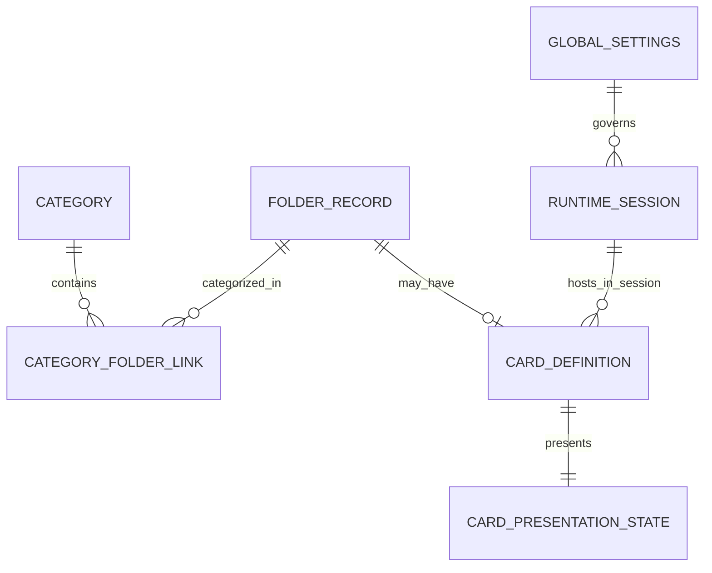

# FolderHub P3-04：CardHost 数据模型与持久化边界

- 文档编号：FH-HLD-DATA-004
- 版本：v0.2
- 日期：2026-11-20
- 工作流规范：software-predev-workflow-skill V2.6.1
- 阶段：P3_HIGH_LEVEL_DESIGN
- 状态：DRAFT / DATA_MODEL_ANALYSIS（非设计基线）
- 输入需求基线：REQ-BL-1.0（SRS v0.11）
- 关联架构决策：ADR-021（全局退出保留行为）；ADR-033（显示环境变化后位置恢复）；ADR-034（每交互用户会话一个 CardHost）；ADR-035（逻辑数据写入权划分）
- 关联问题：Q-152 / CLQ-153（持久化写入权划分，已由用户选择 A 确认）
- 关联任务：TASK-017、TASK-018
- 关联风险：RISK-001（ACCEPTED；兼容性验证义务仍有效）

> 本文只定义逻辑实体、状态分类、持久化边界候选和数据一致性要求。数据库、文件格式、ORM、加密方式、具体表结构、序列化格式均未选定。除 ADR-021、ADR-033、ADR-034、ADR-035 和 REQ-BL-1.0 明确确认的内容外，候选设计均不是用户决定或设计基线。

## 1. 目标与范围

本工作包解决以下问题：

1. 将 SRS v0.11 第 9.1 节的需求层逻辑实体转化为 P3 逻辑数据模型。
2. 区分业务主数据、用户配置、卡片展示状态、进程运行状态和派生缓存。
3. 明确主应用退出后 CardHost 仍能独立运行时，卡片位置/锁定状态如何保存。
4. 避免 Main Process 与 CardHost 对同一数据字段无协调双写，防止旧快照覆盖新状态。
5. 为 IPC、异常恢复、升级迁移和后续详细设计提供稳定数据契约。

不在本轮确定：SQLite/文件存储/注册表等技术、物理表结构、数据加密方案、备份文件格式、具体坐标算法、IPC 实现和即时崩溃恢复 SLA。

## 2. 需求约束（不可改变）

| 来源 | 已批准约束 | 对数据设计的影响 |
|---|---|---|
| FR-016 / ADR-007 | 每个文件夹可单独启用/关闭独立卡片；卡片显示图标、名称、用途说明；多个卡片可同时存在；各自移动和锁定 | 卡片必须有稳定标识，并关联文件夹记录；每张卡片的展示状态独立保存 |
| FR-017 / BR-012 / ADR-021 | 全局统一“主程序退出后保留卡片”开关，默认开启；关闭时全部卡片随主程序退出关闭；无逐卡片覆盖 | 全局策略与单卡片启用状态必须区分，不能创建 per-card keep-on-exit 字段 |
| FR-019 / ADR-033 | 主组件与每张卡片分别恢复显示位置；原显示器可用且位置可见时尽量保持；否则迁移至当前主显示器可见位置 | 主组件和每张卡片都需保存足以恢复位置的逻辑数据；显示器/DPI 细节算法仍待设计 |
| NFR-002 | 主组件及每张卡片位置和锁定状态跨应用重启保存；透明度自动保存 | 卡片状态必须在 CardHost 独立运行期间可持久化，不能依赖已退出的主进程 |
| ADR-034 | 每个交互式用户会话一个独立 CardHost；主程序退出且保留开关开启时 CardHost 继续运行 | CardHost 必须有独立可用的持久化访问路径及确定的写入权 |
| ADR-019 / FR-010 | 路径异常时保留文件夹记录，不自动删除真实目录或 FolderHub 记录 | 路径可用性是状态，不是删除条件 |
| ADR-028 / FR-018 | 同一实际文件夹路径只保留一条文件夹记录 | 逻辑模型需要路径唯一性约束；路径规范化/比较算法待实现设计 |

## 3. 逻辑实体模型

以下为设计层逻辑实体，不等于数据库表。实体标识应稳定，不使用显示名称或路径作为主键。

| 实体 | 关键逻辑字段 | 关系/约束 | 来源 |
|---|---|---|---|
| Category | CategoryId、Name、SortOrder | 平级；排序在分类内独立 | ADR-010、ADR-023 |
| FolderRecord | FolderId、Path、Alias、Description、PathStatus、CreatedAt/UpdatedAt | 一个实际路径一条记录；可关联多个分类 | ADR-017～ADR-019、ADR-028 |
| CategoryFolderLink | CategoryId、FolderId、SortOrder | Category 与 FolderRecord 多对多；每个分类独立排序 | ADR-009、ADR-024 |
| MainComponentSettings | Pinned、Position、Locked、Opacity、StartupEnabled | 每个 Windows 用户配置一份逻辑配置；主组件位置/锁定跨重启保存 | ADR-003、ADR-005、ADR-013、ADR-014、ADR-027、FR-014/015 |
| CardDefinition | CardId、FolderId、Enabled | 关联一个 FolderRecord；每个文件夹按 FR-016 启用/关闭独立卡片；稳定 CardId | ADR-007、FR-016 |
| CardPresentationState | CardId、Position、Locked、MonitorReference、DpiReference、StateVersion、UpdatedAt | 每张卡片独立；Monitor/DPI 字段仅为候选逻辑信息，具体表达待设计 | ADR-033、NFR-002 |
| GlobalSettings | KeepCardsAfterMainExit | 全局统一，默认 true；不得下沉为每卡片设置 | ADR-021、FR-017、BR-012 |
| RuntimeSession | SessionId、UserSidReference、HostInstanceId、ProtocolVersion、StartedAt、HostState | 仅运行期状态；SessionId 不作为跨重启的卡片业务主键 | ADR-034 |

### 3.1 逻辑关系图

说明：`FolderRecord` 与 `CardDefinition` 的一对零或一关系是对当前 SRS“每个文件夹可单独启用/关闭一个独立卡片”的逻辑映射；若后续需求确认允许同一文件夹创建多个独立卡片实例，必须先做需求影响分析，不在本轮自行扩展。

## 4. 数据分类与生命周期

| 数据类别 | 典型内容 | 生命周期 | 持久化要求 |
|---|---|---|---|
| 业务主数据 | 分类、文件夹路径、别名、用途说明、分类关联 | 跨主程序重启；按用户操作新增/编辑/删除 | 持久保存；路径异常不得触发自动删除 |
| 主组件用户配置 | 固定状态、位置、锁定、透明度、开机启动 | 跨应用重启 | 自动保存；显示环境变化按 FR-019 恢复 |
| 卡片定义/启用状态 | CardId、FolderId、Enabled | 跨应用重启；受用户启停操作管理 | 持久保存；与全局退出保留设置分离 |
| 卡片展示状态 | 每张卡片位置、锁定、显示器恢复参考 | 跨主程序重启；CardHost 独立运行时持续更新 | CardHost 可在 Main Process 不存在时保存 |
| 全局策略配置 | KeepCardsAfterMainExit | 跨应用重启 | 单一全局字段，默认开启；无 per-card 覆盖 |
| 运行期状态 | HostState、IPC 连接、请求 ID、临时窗口句柄 | 进程/会话生命周期 | 默认不作为业务配置持久化；诊断日志按策略记录 |
| 派生缓存 | 卡片显示用名称/说明/图标缓存、配置快照 | 可重建 | 不作为权威数据；需带源版本/时间戳，过期可刷新 |

## 5. 持久化写入权：候选方案

### 5.1 方案 A：按逻辑聚合划分单一写入者（推荐）

- Main Process 是 Category、FolderRecord、CategoryFolderLink、MainComponentSettings、GlobalSettings 及 CardDefinition 的权威写入者。
- CardHost 是 CardPresentationState 的唯一权威写入者；用户拖动、锁定或显示环境恢复时由 CardHost 直接提交状态，不依赖 Main Process 在线。
- Main Process 通过 IPC 向 CardHost 发送卡片新增/移除/启停及元数据快照；CardHost 不直接改写业务主数据。
- CardHost 回报卡片状态变更事件，但 Main Process 不能用旧快照覆盖 CardHost 已提交的 StateVersion。
- 物理存储可由同一持久化后端承载不同聚合，也可在适配器后拆分；本方案只确认逻辑写入权，不指定数据库或文件布局。

优点：符合 ADR-034 主程序可退出的运行方式；字段级单写者清晰；业务主数据与桌面窗口状态解耦；CardHost 可独立保存位置/锁定状态。

缺点/风险：跨进程持久化适配器需要明确并发和事务边界；Main Process 与 CardHost 的快照/增量同步需要版本对账；实现必须防止 Main Process 旧状态回写。

### 5.2 方案 B：CardHost 独立拥有全部卡片聚合存储

- Main Process 通过 IPC 请求 CardHost 新增、启停、更新卡片；CardHost 成为 CardDefinition 与 CardPresentationState 的唯一权威写入者。
- Main Process 仍拥有 FolderRecord 等业务主数据，并向 CardHost 提供元数据快照。

优点：卡片配置与窗口状态集中在 CardHost；CardHost 独立运行时不存在对 Main Process 的写入依赖；卡片聚合内部事务边界清楚。

缺点/风险：主程序卡片管理依赖 CardHost 可用；业务主数据与卡片聚合跨存储一致性更复杂；删除/改路径/修改别名等操作需要 IPC 协调及失败补偿；主应用恢复时需要重建/对账流程。

### 5.3 方案 C：Main Process 拥有全部数据，CardHost 仅发送状态事件

- Main Process 是所有卡片配置与展示状态的唯一写入者；CardHost 将拖动/锁定事件发送给 Main Process 保存。
- 主程序退出后 CardHost 仍运行，但不能直接完成持久化；需增加本地日志/队列，等待 Main Process 下次启动回放。

优点：单一权威写入入口；业务数据和卡片数据一致性较易集中管理。

缺点/风险：主程序退出期间依赖本地队列；队列崩溃/损坏/回放冲突需额外处理；增加数据丢失窗口；与“CardHost 独立运行”目标耦合不佳。

### 5.4 方案 D：独立 Persistence Host / Service

- 由第三个进程或服务提供持久化 API；Main Process 和 CardHost 都通过 IPC 访问。

优点：集中事务、备份、迁移和访问控制；客户端不直接竞争存储。

缺点/风险：增加第三进程或服务安装/启动/权限/升级/故障恢复复杂度；若采用 Windows Service 还需遵守 Session 0 隔离；当前尚无证据表明有必要引入。

## 6. 推荐结论（未获用户确认）

推荐方案 A，置信度：中高。

依据：
1. ADR-034 已确认主应用可退出而 CardHost 继续运行；卡片位置和锁定状态必须在主应用退出期间仍可保存。
2. NFR-002 要求卡片位置和锁定状态跨应用重启保存；FR-019 要求每张卡片独立恢复。
3. 将 FolderRecord 等业务主数据留在 Main Process，将 CardPresentationState 的写入权交给 CardHost，能在字段/聚合层面实现单写者，避免对同一字段无协调双写。
4. 不需要仅为持久化额外引入 Windows Service 或第三个常驻进程。

推荐边界：方案 A 是逻辑写入权划分，不是数据库技术选择，也不意味着两个进程可以无约束地同时更新同一字段。物理存储布局、并发控制、事务策略、备份/恢复和迁移必须在后续设计中明确。

## 7. 版本与一致性规则（候选要求）

- 每个持久化聚合应具有单调递增的版本号或等效并发控制标识。
- CardHost 更新 CardPresentationState 时使用 CardId + ExpectedStateVersion；版本不匹配时返回冲突，不静默覆盖。
- Main Process 向 CardHost 发送快照/增量时带 CatalogVersion；CardHost 对已应用版本做幂等处理。
- 卡片状态写入成功后才确认对应 UI 状态已持久化；写入失败必须保留可重试/可诊断状态，不得伪报保存成功。
- 删除 FolderRecord 时先检查 CardDefinition；卡片关闭/移除和业务记录删除需要有明确事务或补偿流程，不能留下不可恢复孤儿卡片。
- 路径、别名、用途说明等元数据以 FolderRecord 为准；CardHost 缓存只用于主程序退出期间展示，重新连接后按 CatalogVersion 更新。
- 全局 KeepCardsAfterMainExit 由 Main Process 管理；退出前通过带请求 ID 和设置版本的 IPC 命令传递退出策略。CardHost 不维护 per-card keep 标志。

以上为推荐设计约束，用户确认前保持候选状态。

## 8. 位置数据逻辑模型（不指定坐标算法）

每个主组件/卡片的 Position 至少需要表达：

- 坐标值及其坐标空间标识（例如窗口坐标/桌面逻辑坐标，具体选择待设计）；
- 关联显示器的稳定识别信息或可恢复匹配信息；
- 保存时的显示器工作区/分辨率/DPI 参考信息（具体字段待验证）；
- 窗口尺寸/边界信息（用于 FR-019 可见区域判断；卡片尺寸来源需遵守现有需求/历史记录）；
- PositionVersion / UpdatedAt，用于检测旧状态覆盖。

不得将瞬时 HWND、屏幕枚举索引或进程句柄作为持久化标识。显示器标识、坐标空间、DPI 换算、工作区与冲突避让算法均为 `NEEDS_VALIDATION`，不得在本文件中写成已选技术。

## 9. 删除、迁移、备份与损坏恢复边界

- 业务记录删除与真实磁盘目录删除严格分离；FolderHub 不执行真实目录删除（NFR-003）。
- 删除文件夹记录时，需协调关闭关联卡片并删除卡片定义/展示状态；若 CardHost 不可用，应记录待协调状态，不能静默留下孤儿窗口或丢失业务记录。
- 数据迁移应版本化；升级前备份；迁移后执行完整性校验；迁移失败具备回滚/恢复路径。具体方案待技术栈确定。
- 持久化损坏时不得无提示地初始化空数据覆盖原数据；应保留损坏证据并提供可诊断恢复流程。备份恢复的业务行为以 SRS 第 18 章既有已确认内容为准。
- 卡片位置状态可重建与否需区分：若状态损坏，允许安全回退到可见默认位置属于候选恢复策略，仍须确保不会覆盖可恢复的原始状态；具体用户提示和备份行为待后续分析。

## 10. 未决事项与验证计划

| 编号 | 未决项 | 当前处理 | 验证/关闭条件 |
|---|---|---|---|
| DATA-01 | 持久化写入权采用 A/B/C/D 哪种 | 用户选择 A 已确认，见 ADR-035 | 已新增 ADR-035；验证主程序退出期间卡片位置/锁定仍可保存 |
| DATA-02 | 逻辑存储拆分及物理后端 | `NEEDS_VALIDATION`；不在 Q-152 一并确认 | 技术选型比较、目标 OS 兼容性和并发写入原型 |
| DATA-03 | 卡片启停状态与 CardPresentationState 的事务边界 | 以已确认的 DATA-01 单写者边界为前提；事务/补偿机制仍待设计 | 卡片启停、文件夹删除、主程序断连的失败注入测试 |
| DATA-04 | 同一用户多交互会话的持久化隔离 | `DESIGN_ASSUMPTION`：目标是单用户交互式桌面，RDS 多用户不支持；同一 SID 多会话行为待验证 | 检查目标 Windows 版本会话场景，确定按用户配置还是按会话配置 |
| DATA-05 | 显示器标识/坐标空间/DPI 参考字段 | `NEEDS_VALIDATION` | 覆盖显示器热插拔、分辨率、缩放、远程桌面场景的原型验证 |
| DATA-06 | 数据损坏、迁移失败、备份恢复 | 业务规则已有基线，物理机制待设计 | 迁移/损坏注入、备份恢复和回滚验证 |

## 11. 需求追踪

| 需求 | 本文覆盖 | 后续验证 |
|---|---|---|
| FR-016 | CardDefinition、CardPresentationState、稳定 CardId | 多卡片启停/独立位置锁定 |
| FR-017 / BR-012 | GlobalSettings.KeepCardsAfterMainExit；不设 per-card 覆盖 | 开关开启/关闭的主程序退出时序 |
| FR-019 | Position 与显示环境参考数据 | 多显示器/DPI 变化后分别恢复 |
| NFR-002 | 主组件/卡片位置锁定持久化；CardHost 可独立保存 | 主程序退出期间移动/锁定后重启恢复 |
| NFR-003 | FolderRecord 删除不影响磁盘目录 | 删除/路径失效/恢复测试 |
| ADR-034 | CardHost 进程独立期间持久化可用 | CardHost 无 Main Process 时写入与恢复 |
| ADR-028 | FolderRecord 路径唯一性 | 路径规范化/比较专项测试 |

## 12. 基线与变更边界

- 本文不修改 SRS v0.11 / REQ-BL-1.0、RAW、CR-001 或 RISK-001；ADR-035 仅记录用户对逻辑写入权的确认。
- 本文的实体模型、接口和物理存储候选均为 P3 草案；Q-152 的逻辑写入权选择已由用户确认并记录为 ADR-035，但本文仍为 DRAFT，不构成概要设计基线。
- 若后续设计发现需求本身缺少必要的数据语义，应先建立需求影响分析；不得通过设计文档擅自扩展已批准需求。
- P3 仍为 `IN_PROGRESS`；P4 仍为 `NOT_STARTED`。

## 13. 修订记录

- v0.1（2026-11-20）：依据 REQ-BL-1.0、ADR-021/033/034 和 P3-03 形成逻辑数据实体、持久化边界候选、单写者规则和验证计划；提交 Q-152 / CLQ-153 用户确认；非设计基线。
- v0.2（2026-11-20）：追加用户对 Q-152 / CLQ-153 选项 A 的明确选择；将逻辑写入权划分标记为 USER_CONFIRMED_DECISION 并关联 ADR-035；DATA-01 关闭。数据库、物理存储布局、IPC 技术、事务/补偿和恢复机制仍未选定；本文仍为 DRAFT / 非设计基线。

## 14. 用户确认的逻辑写入权模型（ADR-035；2026-11-20）

**USER_CONFIRMED_DECISION：**用户选择 Q-152 / CLQ-153 方案 A，按逻辑聚合划分单一权威写入者：

| 逻辑聚合 | 权威写入者 | 关键字段/范围 |
|---|---|---|
| Category / FolderRecord / CategoryFolderLink | Main Process | 分类、路径、别名、用途说明、分类关联和排序 |
| MainComponentSettings / GlobalSettings | Main Process | 主组件配置、全局退出保留策略 |
| CardDefinition | Main Process | 卡片与 FolderRecord 关联、启用/停用定义 |
| CardPresentationState | CardHost | 卡片位置、锁定、显示器/DPI 恢复参考和状态版本 |
| RuntimeSession / 临时缓存 | 对应进程 | 运行期会话和可重建缓存；不得成为跨进程业务主数据权威来源 |

该模型只确定逻辑所有权。物理存储可以在后续技术比较后采用单文件分区、分离文件或其他实现，但必须保持单一逻辑写入者、会话隔离和版本防旧写规则。共享数据库文件不是本次用户选择的隐含结论。

### DATA-01 当前状态

- 状态：`CLOSED / CONFIRMED`；D2。
- 四维评估：记录完整性 `COMPLETE`；决策完成度 `CONFIRMED`；阶段阻塞性 `NON_BLOCKING`（对本题）；延期有效性 `NOT_DEFERRED`。
- 后续依赖项：DATA-02 物理存储后端、DATA-03 跨聚合事务/补偿、DATA-04 多会话隔离、DATA-05 显示环境字段、DATA-06 迁移/备份恢复，继续按验证/设计工作追踪，不等同于新增用户决策。
